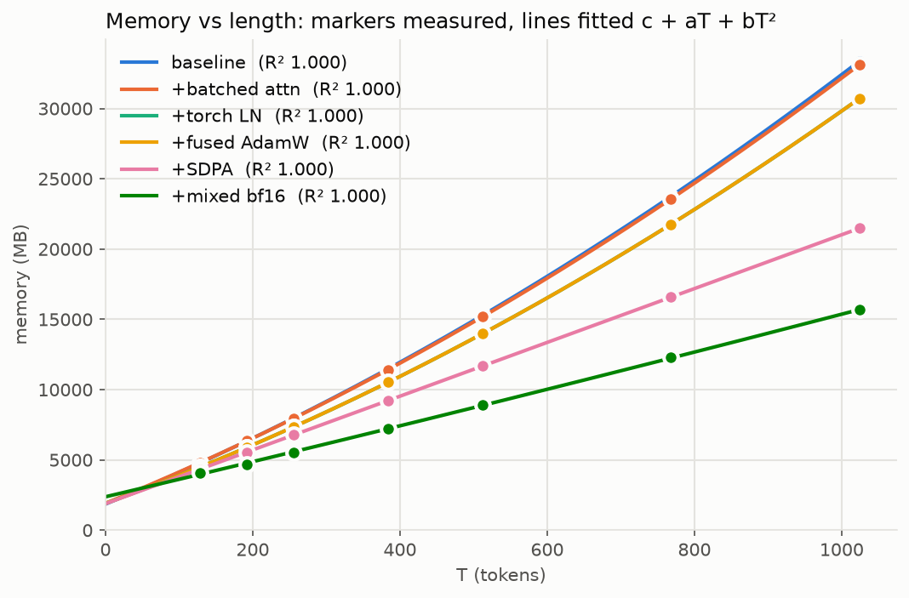

### Memory model fit: mem(T) = c + a T + b T²

| variant       | c (MB) | a (MB/token) | b (MB/token²) | T² share at max T (%) |     R² | points |
| ------------- | -----: | -----------: | ------------: | --------------------: | -----: | -----: |
| baseline      |  1,853 |       21.681 |      8.88e-03 |                    28 | 1.0000 |      7 |
| +batched attn |  1,912 |       21.360 |      8.89e-03 |                    28 | 1.0000 |      7 |
| +torch LN     |  1,902 |       19.041 |      8.88e-03 |                    30 | 1.0000 |      7 |
| +fused AdamW  |  1,902 |       19.041 |      8.88e-03 |                    30 | 1.0000 |      7 |
| +SDPA         |  1,886 |       19.096 |      3.59e-05 |                     0 | 1.0000 |      7 |
| +mixed bf16   |  2,374 |       12.374 |      6.17e-04 |                     4 | 0.9998 |      7 |

### Configuration

- **preset:** stories_cfg
- **device:** cuda
- **vocab_size:** 50257
- **batch_size:** 16
- **warmup:** 5
- **out_dir:** results/full
- **from_csv:** False
- **overwrite:** False
- **log_level:** 20
- **block_sizes:** [128, 192, 256, 384, 512, 768, 1024]
- **iters:** 20
- **trials:** 3
- **batch:** 16
- **kind:** benchmark_train
- **run_dir:** results/full/benchmark_train_stories_cfg_cuda

### Environment

- **date:** 2026-10-16T02:53:28
- **git:** v0.1.0-1-g53a1038
- **python:** 3.12.3
- **torch:** 2.14.0+cu130
- **os:** Linux-6.8.0-124-generic-x86_64-with-glibc2.39
- **cpu:** x86_64
- **ram (GB):** 2016
- **torch cpu threads:** 12
- **device:** cuda
- **gpu:** NVIDIA A100-SXM4-80GB, 79 GB
