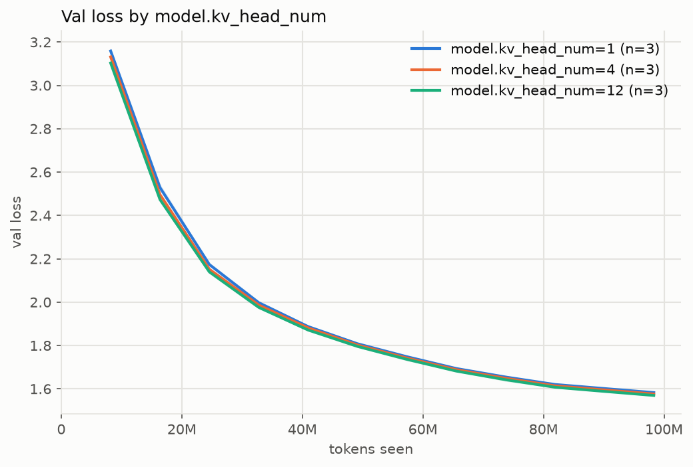

### Validation loss by model.kv_head_num (mean over runs; band in the plot is min-max)

| run / group          | runs |     tokens | final val |  ± std | best val |  ± std |
| -------------------- | ---: | ---------: | --------: | -----: | -------: | -----: |
| model.kv_head_num=1  |    3 | 98,304,000 |    1.5827 | 0.0046 |   1.5827 | 0.0046 |
| model.kv_head_num=4  |    3 | 98,304,000 |    1.5762 | 0.0039 |   1.5762 | 0.0039 |
| model.kv_head_num=12 |    3 | 98,304,000 |    1.5694 | 0.0065 |   1.5694 | 0.0065 |

### Runs

`../runs/baseline_s*, ../runs/kv4_s*, ../runs/kv1_s*`
