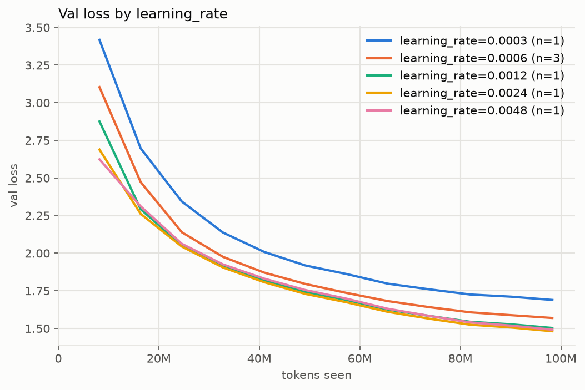

### Validation loss by learning_rate (mean over runs; band in the plot is min-max)

| run / group          | runs |     tokens | final val |  ± std | best val |  ± std |
| -------------------- | ---: | ---------: | --------: | -----: | -------: | -----: |
| learning_rate=0.0003 |    1 | 98,304,000 |    1.6891 |      — |   1.6891 |      — |
| learning_rate=0.0006 |    3 | 98,304,000 |    1.5694 | 0.0065 |   1.5694 | 0.0065 |
| learning_rate=0.0012 |    1 | 98,304,000 |    1.5032 |      — |   1.5032 |      — |
| learning_rate=0.0024 |    1 | 98,304,000 |    1.4816 |      — |   1.4816 |      — |
| learning_rate=0.0048 |    1 | 98,304,000 |    1.4918 |      — |   1.4918 |      — |

### Runs

`../runs/baseline_s*, ../runs/lr*`
