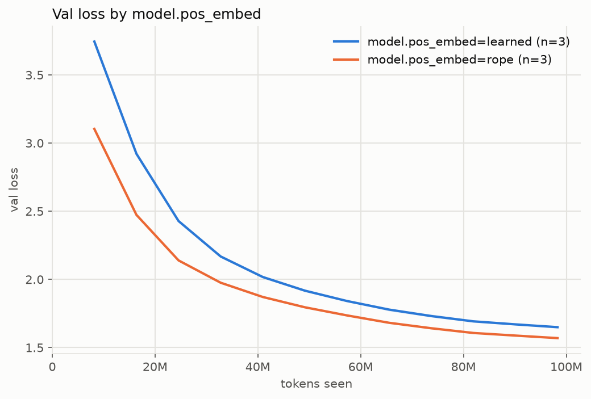

### Validation loss by model.pos_embed (mean over runs; band in the plot is min-max)

| run / group             | runs |     tokens | final val |  ± std | best val |  ± std |
| ----------------------- | ---: | ---------: | --------: | -----: | -------: | -----: |
| model.pos_embed=learned |    3 | 98,304,000 |    1.6497 | 0.0096 |   1.6497 | 0.0096 |
| model.pos_embed=rope    |    3 | 98,304,000 |    1.5694 | 0.0065 |   1.5694 | 0.0065 |

### Runs

`../runs/baseline_s*, ../runs/learned_s*`
