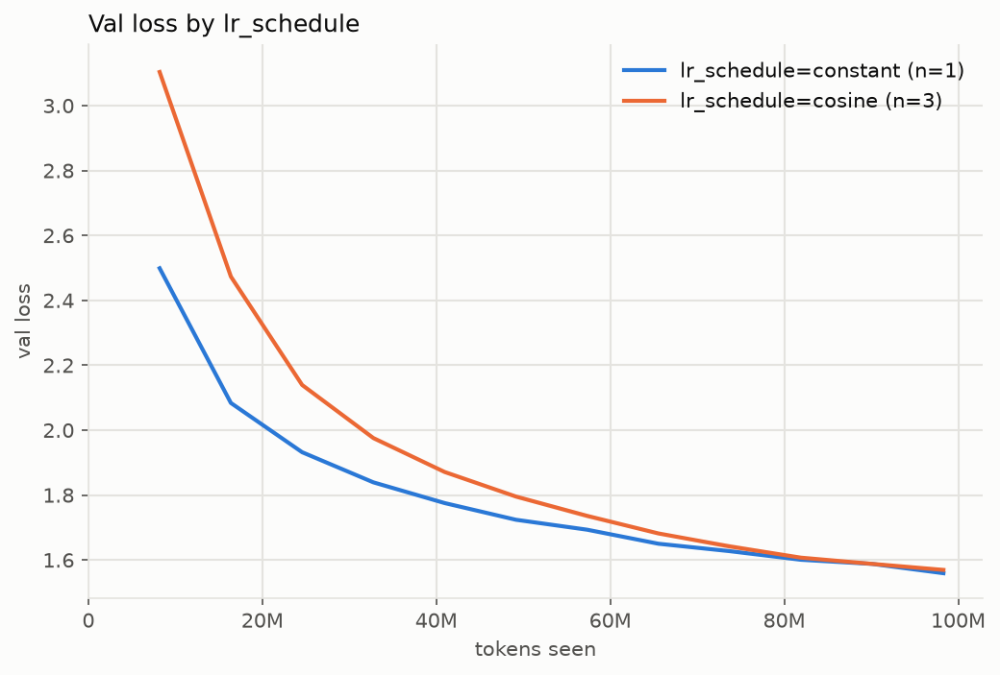

### Validation loss by lr_schedule (mean over runs; band in the plot is min-max)

| run / group          | runs |     tokens | final val |  ± std | best val |  ± std |
| -------------------- | ---: | ---------: | --------: | -----: | -------: | -----: |
| lr_schedule=constant |    1 | 98,304,000 |    1.5592 |      — |   1.5592 |      — |
| lr_schedule=cosine   |    3 | 98,304,000 |    1.5694 | 0.0065 |   1.5694 | 0.0065 |

### Runs

`../runs/baseline_s*, ../runs/constant_s0`
