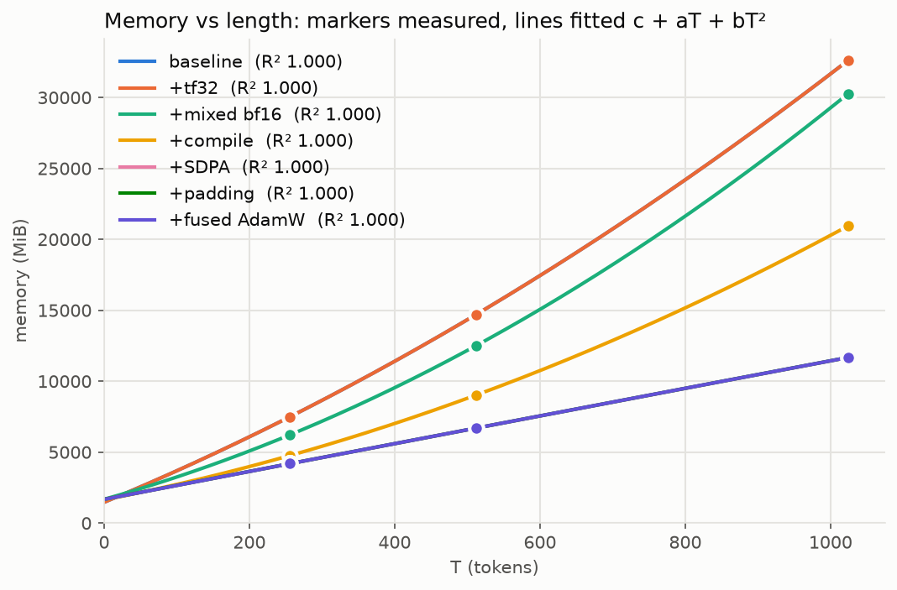

### Memory model fit: mem(T) = c + a T + b T²

| variant      | c (MiB) | a (MiB/token) | b (MiB/token²) | T² share at max T (%) |     R² | points |
| ------------ | ------: | ------------: | -------------: | --------------------: | -----: | -----: |
| baseline     |   1,466 |        21.275 |       8.92e-03 |                    29 | 1.0000 |      3 |
| +tf32        |   1,466 |        21.275 |       8.92e-03 |                    29 | 1.0000 |      3 |
| +mixed bf16  |   1,676 |        14.380 |       1.32e-02 |                    46 | 1.0000 |      3 |
| +compile     |   1,640 |         9.979 |       8.67e-03 |                    43 | 1.0000 |      3 |
| +SDPA        |   1,672 |         9.847 |      -8.38e-05 |                    -1 | 1.0000 |      3 |
| +padding     |   1,675 |         9.846 |      -8.01e-05 |                    -1 | 1.0000 |      3 |
| +fused AdamW |   1,669 |         9.865 |      -9.43e-05 |                    -1 | 1.0000 |      3 |

### Configuration

- **preset:** gpt2_cfg
- **device:** cuda
- **vocab_size:** None
- **batch_size:** 16
- **warmup:** 5
- **out_dir:** results/gpt2_full
- **from_csv:** False
- **overwrite:** False
- **log_level:** 20
- **block_sizes:** [256, 512, 1024]
- **iters:** 20
- **trials:** 3
- **batch:** 16
- **kind:** benchmark_train
- **run_dir:** results/gpt2_full/benchmark_train_gpt2_cfg_cuda
- **vocab:** 50257

### Environment

- **date:** 2026-11-27T04:25:29
- **git:** v1.0.0-39-g96be5de
- **python:** 3.12.3
- **torch:** 2.14.1+cu126
- **os:** Linux-6.14.0-24-generic-x86_64-with-glibc2.39
- **cpu:** x86_64
- **ram (GB):** 945
- **torch cpu threads:** 24
- **world size:** 1
- **device:** cuda
- **gpu:** NVIDIA A100-SXM4-80GB, 79 GB
