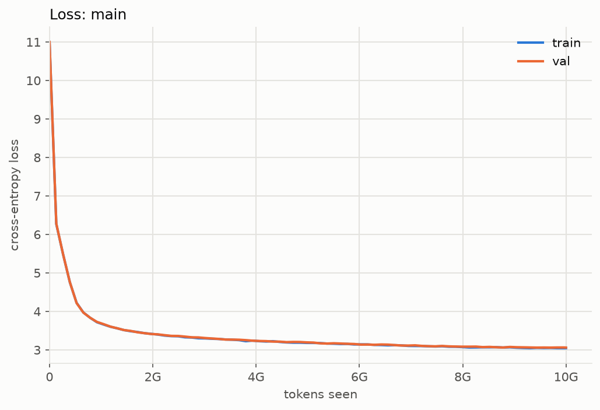
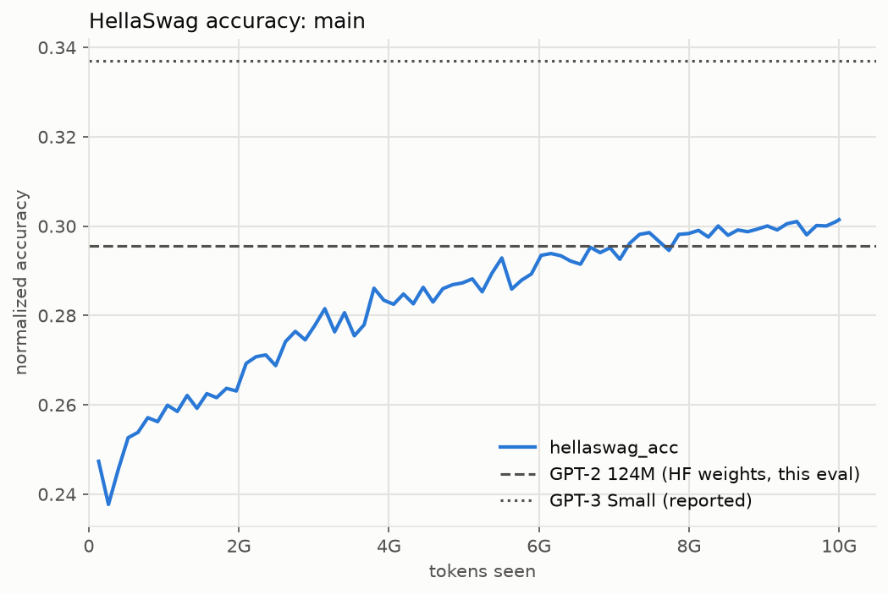

# GPT-2

GPT-2 124M ([Radford et al., 2019](https://cdn.openai.com/better-language-models/language_models_are_unsupervised_multitask_learners.pdf)) reproduced following [Andrej Karpathy's tutorial](https://www.youtube.com/watch?v=l8pRSuU81PU), on top of the [NanoGPT](NANOGPT.md) codebase: a 124.5M-parameter model trained on 10.0B [FineWeb-Edu](https://huggingface.co/datasets/HuggingFaceFW/fineweb-edu) tokens on 8× A100 80GB in 1 h 41 min of training steps, reaching a best validation loss of 3.0598 and HellaSwag accuracy of 0.3014, plus benchmarks and DDP experiments, all reproducible with one script.

## Beyond the Tutorial

The model and training recipe follow the video: TF32, mixed bf16, `torch.compile`, Flash attention, vocabulary padding, the GPT-3 hyperparameters with fused AdamW, gradient accumulation, DDP, FineWeb-Edu, and HellaSwag. What's added:

- **Measurement:** the optimization journey benchmarked step by step (throughput, peak memory, and MFU at three sequence lengths), a DDP scaling curve, the compile-order comparison, and a recompile check.
- **Reliability:** exact resume under DDP (every rank's RNG state checkpointed), a 6-step check of the main run's path on all GPUs, a laptop smoke mode, and one-command reproduction (`scripts/reproduce_gpt2.sh`).
- **Testing:** gradient accumulation vs. one large batch, DDP on CPU/gloo vs. a single process, gradient sync once per step for both compile orders, and resume vs. a continuous run.
- **Data:** pinned dataset revision, SHA-256 checksums verified before training, and resumable preparation on a CPU-only machine.

## Highlights

All on A100-SXM4-80GB: benchmarks on one GPU, training on eight.

- **DDP scaling 94.6%** using 8 GPUs compared to the baseline training using a single GPU.
- **Training throughput 8.0–11.1×** across the optimization journey ($T$ = 256–1024). TF32 tensor cores and `torch.compile` dominate; bf16 adds only +14–16% because it comes after TF32, which already moved the matmuls onto the tensor cores.
- **Peak memory up to −64%** across the optimization journey ($T$ = 256–1024). `torch.compile` and SDPA (Flash attention) dominate.
- **56.7% MFU** against the A100's bf16 peak of 312 TFLOP/s.
- **HellaSwag accuracy 0.3014** matches OpenAI's pre-trained GPT-2 124M weights from Hugging Face (0.2966 under the same mixed-bf16 eval); the +0.005 gap is about one standard error over 10,042 examples.
- **Compile order vs. DDP wrap doesn't affect throughput:** 1,666,798 vs. 1,665,089 tok/s (0.1%).

## Results

All results come from commit `96be5de` (`v1.0.0-39-g96be5de`, tag [`gpt2-run-2026-11-27`](https://github.com/reza-mehr/nanogpt/tree/gpt2-run-2026-11-27)) trained on 8× A100-SXM4-80GB-500W with PyTorch 2.14.1+cu126. The frozen snapshot is in [`assets/a100x8_2026_11_27/`](../assets/a100x8_2026_11_27/).

### Trained Model

| | GPT-2 124M |
|---|---|
| Model | 124.5M params, 12 layers, $d$ = 768, learned positions |
| Tokenizer | GPT-2 BPE (50,257) |
| Training | 19,073 steps × 2^19 tokens = 10.0B tokens (≈1 epoch), mixed bf16, cosine lr 6e-4 |
| Time | 101 min of training steps, 1.654M tok/s (56.7% MFU); 113 min for the main run including evaluation, checkpoints, and compiling |
| **Best val loss** | **3.0598** (Karpathy's `train_gpt2.py`: 3.0726) |
| HellaSwag | 0.3014 (OpenAI's GPT-2 124M: 0.2966, same mixed-bf16 eval) |
| Cost | at \$12.81/h for 8× A100: ≈ \$21.6 for the training steps (101 min), ≈ \$24 for the main run (113 min), ≈ \$29 for the full script (136 min) |
| Details | [report](../assets/a100x8_2026_11_27/runs/gpt2_full/main/report.md) |

The figure below shows the training and validation curves:



- **No overfitting:** the final train/val gap is only 0.015 (3.0450 vs. 3.0604).
- **The plateau comes from the schedule:** the cosine decay reaches its floor (6e-5) at the last step, so the updates shrink and the loss flattens as the decay finishes.
- **Past compute-optimal:** 10.0B tokens for 124.5M parameters is ≈80 tokens per parameter, four times the compute-optimal ≈20 ([Hoffmann et al., 2022](https://arxiv.org/abs/2203.15556)). More tokens would still lower the loss, but with diminishing returns. In contrast, the TinyStories model saw about 2 tokens per parameter and was under-trained ([here](NANOGPT.md#trained-models)).

### Samples

Best checkpoint (step 18,500), bf16 weights (`model.pt`), temperature 0.8, top-k 50, seed 0, CPU, 200 new tokens; first sample, not cherry-picked.

- **Pure sampling fails on FineWeb-Edu:** the samples logged during training used temperature 1.0 and no top-k, the same settings that gave fluent text for TinyShakespeare and TinyStories ([here](NANOGPT.md#samples)), and produced nonsense; see them [here](../assets/a100x8_2026_11_27/runs/gpt2_full/main/report.md#samples). FineWeb-Edu is less predictable than TinyStories (3.06 vs. 1.34 nats per token; 1 nat ≈ 1.44 bits), so more probability sits in the long tail, and pure sampling draws from it. Top-k removes the tail, and temperature < 1 sharpens what's left.
- **Both prompts use the same seed,** so their random draws line up step by step; that's why the temperature-1.0 samples share words ("soda", "slopes from").
- **Lower temperature and top-k trade gibberish for repetition:** the first sample loops ("A language model is a type of language model."). A sharper distribution falls into the model's own high-probability loops, because each repeat makes the next one more likely. This degeneration is described by [Holtzman et al., 2019](https://arxiv.org/abs/1904.09751), who propose nucleus (top-p) sampling as a middle ground.

**Prompt** `"Hello, I'm a language model,"`:

```text
Hello, I'm a language model, a language model. A language model is "language model".
A language model is a type of language model. A language model can be a type of language model in a language.
(You may be wondering who defines "language model" but we do not. We are defining it in the first place.)
Language model is a type of language model.
There are many different types of languages. You can find them all in the same language. The most common are English, French, Spanish, German, etc. Even English is a type of the language model we use in our daily lives.
Some languages have over 2000 types. For example, Hindi is a language model even though Hindi is not, it is actually a type of the language of India.
There are several different types of languages. We will discuss them in the next few sections.
- A language model is a type of language model.
- A language model can be a type of language model.
```

**Empty prompt** (starts from `<|endoftext|>`):

```text
The study, published in the Journal of the American Veterinary Medical Association, was the first to examine the relationship between cats and dogs.
“The results showed that in a large sample of cats there was a significant difference in the likelihood of getting a dog from being bitten as a result of the disease. In cats, dogs were more likely than cats to get the disease,” said lead author Dr. Steven Schoenbroek of the University of Cincinnati College of Veterinary Medicine.
The study was conducted in an attempt to determine how cats relate to dogs, and the relationship between the two types of diseases. The researchers followed over 500 cats and dogs for 10 years.
“There was a huge difference in the proportion of dogs that got the disease. At the very beginning I had a few dogs that were all over the street, but that started to turn out to be a little bit more. By the time I was in my four years old, they were probably more often than not
```

### DDP Scaling

Throughput as a function of the number of GPUs, for a fixed batch of 2^19 = 524,288 tokens per optimizer step and 60 steps per run (31.5M tokens). With fewer GPUs, gradient accumulation keeps the batch size the same: the 1-GPU baseline runs 8 accumulation substeps; 8 GPUs run none.

| GPUs | 1 | 2 | 4 | 8 |
|---|---|---|---|---|
| training time (s) | 167 | 87 | 52 | 32 |
| gradient accumulation steps | 8 | 4 | 2 | 1 |
| mean throughput (tok/s) | 220,291 | 433,663 | 837,804 | 1,666,798 |
| speedup vs. 1 GPU | — | 1.97× | 3.80× | 7.57× |
| scaling efficiency (speedup / GPUs) | — | 98.4% | 95.1% | 94.6% |
| peak GPU memory (GiB) | 41.1 | 40.5 | 40.5 | 40.0 |
| mean MFU per GPU (%) | 60.4 | 59.4 | 57.4 | 57.1 |
| details | [report](../assets/a100x8_2026_11_27/runs/gpt2_full/ddp/n1/report.md) | [report](../assets/a100x8_2026_11_27/runs/gpt2_full/ddp/n2/report.md) | [report](../assets/a100x8_2026_11_27/runs/gpt2_full/ddp/n4/report.md) | [report](../assets/a100x8_2026_11_27/runs/gpt2_full/ddp/n8_after_ddp/report.md) |

- **Scaling is near-linear:** most of the gradient all-reduce is hidden behind the backward pass, and the remaining ~5% at 8 GPUs is communication and synchronization that isn't overlapped (profiling it is a [Next Step](#next-steps)).
- **Memory stays flat** because each GPU processes the same micro-batch; only the number of accumulation substeps changes.
- **Per-GPU MFU drops with scaling efficiency,** a cheap sanity check: if they drop together, the lost time is outside the kernels (communication or waiting), not slower compute.

### Training Benchmarks

The impact of the training optimization journey on throughput, peak memory, and model FLOPs utilization (MFU), for `gpt2_cfg` (124.5M params) on 1× A100, batch size 16, 20 iterations after 5 warmup, median of 3 trials. Each row adds to the one above; percentages are changes from the previous row. Full config and tables [here](../assets/a100x8_2026_11_27/results/gpt2_full/benchmark_train_gpt2_cfg_cuda/report.md).

#### Throughput (tokens/sec)

| variant       | $T$ = 256       | $T$ = 512       | $T$ = 1024      |
| ------------- | --------------: | --------------: | --------------: |
| baseline      |  19,184         |  18,480         |  16,403         |
| +tf32         |  63,664 (+232%) |  60,761 (+229%) |  49,316 (+201%) |
| +mixed bf16   |  73,492 (+15%)  |  70,441 (+16%)  |  56,086 (+14%)  |
| +compile      | 127,924 (+74%)  | 140,924 (+100%) | 133,914 (+139%) |
| +SDPA         | 137,235 (+7%)   | 165,526 (+17%)  | 184,640 (+38%)  |
| +padding      | 139,415 (+2%)   | 167,832 (+1%)   | 186,338 (+1%)   |
| +fused AdamW  | 172,847 (+24%)  | 189,866 (+13%)  | 199,208 (+7%)   |
| total vs base |          8.0×   |          9.3×   |        11.1×    |

- **TF32: +201–232%,** but that's 3.3× against an 8× gap in peak (156 vs. 19.5 TFLOP/s): once the matmuls are fast, everything that isn't a matmul starts to dominate.
- **Mixed bf16: only +14–16%,** because it comes after TF32, which already moved the matmuls onto the tensor cores.
- **`torch.compile`: +74–139%:** fusing element-wise ops means fewer kernel launches and fewer round trips to memory.
- **SDPA (Flash attention): +7 to +38%,** growing with $T$, because it doesn't materialize the $T \times T$ attention matrix.
- **Padding the vocabulary to 50,304: +1–2%.**
- **Fused AdamW: +24% at $T$ = 256 but only +7% at $T$ = 1024.** The optimizer step costs the same at any $T$ (it depends only on the 124.5M parameters), while the forward and backward passes grow with tokens per step. At 16 × 256 = 4,096 tokens per step the optimizer is a large share of the step; in the main run (524,288 tokens per step) it's a tiny one, so this gain doesn't carry over.

#### Peak memory (MiB)

| variant       | $T$ = 256     | $T$ = 512      | $T$ = 1024     |
| ------------- | ------------: | -------------: | -------------: |
| baseline      | 7,497         | 14,698         | 32,610         |
| +tf32         | 7,497 (0%)    | 14,698 (0%)    | 32,610 (0%)    |
| +mixed bf16   | 6,223 (-17%)  | 12,503 (-15%)  | 30,259 (-7%)   |
| +compile      | 4,763 (-23%)  |  9,021 (-28%)  | 20,945 (-31%)  |
| +SDPA         | 4,187 (-12%)  |  6,692 (-26%)  | 11,668 (-44%)  |
| +padding      | 4,190 (0%)    |  6,695 (0%)    | 11,673 (0%)    |
| +fused AdamW  | 4,188 (0%)    |  6,695 (0%)    | 11,672 (0%)    |
| total vs base |       (-44%)  |        (-54%)  |        (-64%)  |

- **Mixed bf16: −7 to −17%,** from bf16 activations saved for the backward pass.
- **`torch.compile`: −23 to −31%:** fused kernels keep fewer intermediate tensors for the backward pass.
- **SDPA: −12 to −44%,** growing with $T$, since the $T \times T$ attention matrix is no longer stored.
- TF32, padding, and fused AdamW leave memory unchanged.

#### MFU (%)

| variant       | $T$ = 256    | $T$ = 512    | $T$ = 1024   |
| ------------- | -----------: | -----------: | -----------: |
| baseline      | 75.8         | 75.7         | 71.9         |
| +tf32         | 31.4 (-59%)  | 31.1 (-59%)  | 27.0 (-62%)  |
| +mixed bf16   | 18.1 (-42%)  | 18.0 (-42%)  | 15.4 (-43%)  |
| +compile      | 31.6 (+74%)  | 36.1 (+100%) | 36.7 (+139%) |
| +SDPA         | 33.9 (+7%)   | 42.4 (+17%)  | 50.6 (+38%)  |
| +padding      | 34.4 (+2%)   | 43.0 (+1%)   | 51.1 (+1%)   |
| +fused AdamW  | 42.7 (+24%)  | 48.6 (+13%)  | 54.6 (+7%)   |

- **The denominator is the peak for each row's precision,** from [`peak_flops.csv`](../src/nanogpt/peak_flops.csv): fp32 (baseline) 19.5 TFLOP/s, TF32 (second row) 156 TFLOP/s, bf16 (the rest) 312 TFLOP/s.
    - As a result, MFU is only comparable within one precision: it falls over the first three rows while [throughput](#throughput-tokenssec) rises 3.4–3.8×, because the peak grows faster than the throughput.
    - The baseline's 75.8%: fp32's low peak makes it compute-bound.
- **FLOP counts include the full $T \times T$ attention,** not halved for causal masking, following PaLM ([Chowdhery et al., 2022](https://arxiv.org/abs/2204.02311), Appendix B) and Karpathy.
- **The padded vocabulary's FLOPs are included,** since the padded rows still go through the matmuls.
- **The benchmark matches the main run:** the last row reaches 54.6% MFU at $T$ = 1024 with batch size 16 on one GPU; the main run reached 56.7% with micro-batch 64 on 8 GPUs.

### HellaSwag

**Protocol:** all 10,042 validation examples, every 250 steps (77 evaluations), split across the 8 ranks, under mixed bf16. Completion-style scoring on the raw context: for each of the 4 endings, the cross-entropy is averaged over the ending's tokens, and the ending with the lowest loss is the prediction.



- **Random choice scores 0.25.** At step 500 the model scores 0.238, below chance, likely because per-token loss favors endings made of common tokens until the model uses the context.
- **The run reaches OpenAI's pre-trained GPT-2 124M weights:** it first passes 0.2966 at step 14,000 (7.3B tokens) and stays above it from step 15,000 (7.9B tokens). With a standard error of ≈0.0046, the final 0.3014 matches rather than beats it. Scores for the pre-trained weights with the same code:
    - 0.2955 in fp32 ([report](../assets/a100x8_2026_11_27/results/hellaswag/gpt2_fp32/report.md));
    - 0.2966 in mixed bf16 ([report](../assets/a100x8_2026_11_27/results/hellaswag/gpt2_mixed_bf16/report.md)): 11 more correct answers, from bf16 rounding flipping near-ties in the forward pass;
    - see [this section](#hellaswag-1) for the command to reproduce.
- **GPT-3 Small (125M) scores ≈0.337** ([Brown et al., 2020](https://arxiv.org/abs/2005.14165), zero-shot), after 300B training tokens vs. 10.0B here.
- **About 0.311 is reported for the same weights** with [EleutherAI's lm-evaluation-harness](https://github.com/EleutherAI/lm-evaluation-harness), whose preprocessing and per-character normalization differ from the scoring here; not reproduced in this repo.

### DDP vs Compile Order

This section tests whether the order of wrapping the model in DDP and compiling it affects how communication overlaps with computation. PyTorch [recommends](https://docs.pytorch.org/docs/2.15/notes/ddp.html) wrapping first and compiling the DDP model, so that "TorchDynamo's DDPOptimizer helps by breaking the forward graph at the logical boundaries of DDP's allreduce buckets during backwards" ([TorchDynamo DDPOptimizer](https://docs.pytorch.org/docs/2.15/notes/ddp.html#torchdynamo-ddpoptimizer)).

- **Why the order should matter:** each piece between bucket boundaries is compiled separately, so the all-reduce for one bucket runs while the backward of the next piece is still computing. If the model is compiled first and wrapped after, Dynamo can't see DDP's buckets: the compiled backward runs as one block, and the all-reduce hooks fire only "*after* the whole optimized backwards computation finishes", which removes the overlap.
- **Karpathy compiles first** (`model = torch.compile(model)`, then `DDP(model)`), so this compares the tutorial's order with the recommended one.

| | compile after DDP (recommended) | compile before DDP (Karpathy) |
|---|---|---|
| throughput (tok/s) | 1,666,798 | 1,665,089 |
| peak memory (GiB) | 40.0 | 40.0 |
| MFU (%) | 57.1 | 57.1 |
| details | [report](../assets/a100x8_2026_11_27/runs/gpt2_full/ddp/n8_after_ddp/report.md) | [report](../assets/a100x8_2026_11_27/runs/gpt2_full/ddp/n8_before_ddp/report.md) |

- **The throughputs differ by 0.1%, within run-to-run noise,** so the order makes no measurable difference here.
- **Hypothesis for the tie:** on this NVSwitch node, communication costs only ~5% of the step ([DDP Scaling](#ddp-scaling)). With so little to hide, overlap can recover at most that much. On a slower interconnect, or across nodes, the order would likely matter.
- **Recompiles from the gradient-sync toggle:** on the laptop (2 CPU ranks, 4 accumulation substeps, `TORCH_LOGS=recompiles`), toggling sync caused no recompiles, likely because DDP reads the flag outside the compiled graph. The 8-GPU runs don't accumulate gradients, so they don't test this; checking it on 2 GPUs is a [Next Step](#next-steps).

## Engineering

This release adds the following on top of the [NanoGPT engineering](NANOGPT.md#engineering).

**Distributed**

- **Per-rank RNG checkpoints:** rank 0 gathers every rank's random number generator (RNG) states with `gather_object` and saves them in one checkpoint; on resume, each rank restores its own entry, so resuming a DDP run reproduces the uninterrupted run. Resuming with a different number of GPUs works, but reseeds each rank from the run's seed, step, and rank, so it isn't bit-exact.
- **Device rules:** under DDP every rank calls `torch.cuda.set_device` and passes `ddp.device` (`cuda:<local_rank>`), never a bare `'cuda'` or a `torch.cuda.*` call without a device. CPU/gloo tests can't catch a violation; see [Eval and object collectives on `cuda:0`](#eval-and-object-collectives-on-cuda0).
- **Gradient sync through the compile wrapper:** setting `require_backward_grad_sync` on the compiled DDP model works the same as DDP's `no_sync()` context manager during accumulation substeps, because attribute reads and writes pass through the compile wrapper to the DDP module.

**Data**

- **Sequential data loader:** each rank reads its own strided slice of the token stream, so no two ranks see the same tokens, and reads are contiguous.
- **Independent RNGs:** validation and HellaSwag batches use their own RNGs, separate from the training ranks', so evaluating doesn't change the training batches or the checkpointed state.
- **Data provenance:** the tokenized data records the dataset's repo id and revision, in case the dataset changes upstream, and a SHA-256 checksum of each split, checked before training to catch corruption in transfer between machines.
- **Spawn context in tests:** the HellaSwag test uses `mp.get_context('spawn')`, since `fork()` in a process that already runs threads can deadlock.

**Compile**

- **Compile threads:** with several ranks, `scripts/ddp.sh` sets `TORCHINDUCTOR_COMPILE_THREADS=1`, so each rank compiles in its own process without a worker pool; see [Compile deadlock](#compile-deadlock-at-2-gpus).
- **Fresh compiles per benchmark cell:** each benchmark cell calls `torch._dynamo.reset()`, so it compiles from scratch, and the variants' accumulated recompiles don't hit Dynamo's recompile limit, after which it falls back to eager mode.
- **Matmul precision as a context:** the benchmark step sets the matmul precision once for its whole life cycle and restores the global state afterwards, without adding work inside the timed loop.
- **Profiler regions:** Dynamo ignores `record_function` regions inside compiled code (it warns "Profiler record function … will be ignored"), so the labeled profiles only work on an uncompiled model.

**Run safety**

- **Check phase:** before the main run, `reproduce_gpt2.sh` runs 6 steps on all GPUs with the main run's exact flags (evaluation, checkpointing, sampling, HellaSwag) under a timeout, so a fault in that path costs minutes, not the run. It catches all three issues [below](#lessons-from-the-run).

## Lessons from the Run

All three failures came from paths the laptop tests (CPU, gloo, few cores, tiny models) structurally couldn't reach, which is the case for the [check phase](#engineering): test the real code path on the real hardware, briefly, before the expensive run.

### Compile deadlock at 2 GPUs

- **Symptom:** the run hung at the start of the two-GPU DDP phase (`n2`), after the single-GPU phases had compiled and run normally. GPU 0 sat at 100% "utilization", GPU 1 at 0%, with no log output for five minutes.
- **Diagnosis:** Fabric Manager was running, which ruled out the NVSwitch interconnect, and py-spy showed where each rank was. Rank 1 was stuck in `torch._inductor.compile_worker.subproc_pool._recv_msg`, waiting for a result from `torch.compile`'s pool of parallel compile workers that never arrived. Rank 0 had finished compiling and was waiting for rank 1 inside an NCCL collective; NCCL's waiting kernels spin, which is the 100% on GPU 0.
- **Cause:** not hardware or NCCL, but a deadlock in one rank's compilation, most likely from several ranks compiling a full GPT-2 at once, each starting a worker pool sized to the 192-core machine. Pool hangs like this depend on timing and load, so the laptop's DDP tests couldn't trigger it.
- **Fix:** `TORCHINDUCTOR_COMPILE_THREADS=1`, now set by `scripts/ddp.sh` ([Compile threads](#engineering)); the check phase now catches this class of hang in the first minutes. The restart cost about 12 minutes of repeated setup and benchmarks.

### Eval and object collectives on `cuda:0`

- **Symptom:** under DDP, evaluation batches landed on `cuda:0` for every rank, and `gather_object` failed with "Tensor found on device cuda:0".
- **Cause:** a bare `'cuda'` means the current device, which is `cuda:0` unless `torch.cuda.set_device` is called. Training was unaffected because DDP's `forward` moves its inputs to the rank's device, which hid the bug; evaluation and object collectives don't go through that path.
- **Fix:** the [device rules](#engineering): `set_device` before process-group init, and `ddp.device` everywhere else.

### Fabric Manager restarted by background updates

- **Symptom:** the benchmarks failed with "unspecified launch failure", on the same node where they had run cleanly before.
- **Diagnosis:** the kernel log showed Xid 45 (robust channel recovery), and the Fabric Manager and apt journals showed Ubuntu's unattended-upgrades restarting Fabric Manager during the run.
- **Cause:** on NVSwitch systems, restarting Fabric Manager kills running CUDA processes.
- **Fix:** disable the apt timers and unattended-upgrades first thing after boot ([Setup](#setup)). The incident cost about 27 minutes (≈ \$5.80).

## Next Steps

- **Measure OpenAI's GPT-2 124M val loss** on the same val split, for a like-for-like baseline.
- **Move temperature and top-k into the configs** instead of hard-coding them in the trainer's sampling.
- **Profile compute/communication overlap** under DDP, for both compile orders.
- **Check recompiles from the gradient-sync toggle on 2 GPUs.**
- **Record the dataset config** (`sample-10BT`) in the tokenized data's `meta.json`, next to the repo id and revision.

## Usage

The pipeline has two steps. `scripts/prepare_gpt2_data.sh` downloads and tokenizes FineWeb-Edu and downloads HellaSwag; it needs no GPU, so it can run on a cheaper CPU-only machine. `scripts/reproduce_gpt2.sh` then runs everything else on the GPU node. Both read the same `DATA_ROOT` (`data` in the repo by default).

Moving the data between machines is left to you, outside the scripts. An object store such as Google Cloud Storage works well: keep the bucket in the same region as both machines, so the copies stay within the provider's network and avoid the bottleneck of downloading over the internet.

### Setup

The environment setup is in the [main README](../README.md#setup). The steps below are for a rented 8-GPU Linux node, with the data in a Google Cloud Storage bucket. Replace `<public-ip>`, `<key>`, `<repo-url>`, `<project-id>`, `<bucket>`, and `<service-account-key>` with your own values. Paths assume the node's large local disk is mounted at `/ephemeral`; training reads memory-mapped files, so the data must be on local disk, not a network mount.

**1. Prepare and upload the data** (on any machine; no GPU needed). In a container, set `NUM_PROC` to the CPU quota, since `os.cpu_count()` reports the host's cores there:

```bash
NUM_PROC=32 bash scripts/prepare_gpt2_data.sh full
gcloud storage rsync -r data/fineweb gs://<bucket>/data/fineweb
```

**2. Connect, then stop Ubuntu's background updates first thing.** They can restart Fabric Manager, which kills running CUDA processes on NVSwitch systems (see [Lessons from the Run](#fabric-manager-restarted-by-background-updates)):

```bash
ssh -i <key> -o IdentitiesOnly=yes ubuntu@<public-ip>

sudo systemctl disable --now unattended-upgrades apt-daily.timer apt-daily-upgrade.timer
pgrep -c -f 'unattended-upgrade|apt'        # must print 0
```

**3. Check the hardware:**

```bash
nvidia-smi --query-gpu=index,name,memory.used --format=csv,noheader     # 8 GPUs, ~0 MiB used
systemctl is-active nvidia-fabricmanager                                # active
nvidia-smi topo -m | grep -c 'NV12.*NV12.*NV12.*NV12.*NV12.*NV12.*NV12' # 8: every GPU pair on NVLink
df -h /ephemeral | tail -1                                              # free space for data and caches
```

**4. Set up the workspace on local disk, inside `screen`** so the run survives a dropped SSH connection:

```bash
sudo chown ubuntu:ubuntu /ephemeral
mkdir -p /ephemeral/{hf_cache,uv_cache,tmp}
sudo apt-get update -qq && sudo apt-get install -y -qq screen
screen -S gpt2

# Inside screen: keep caches and temporary files on local disk, and cap CPU threads per rank:
export HF_HOME=/ephemeral/hf_cache UV_CACHE_DIR=/ephemeral/uv_cache TMPDIR=/ephemeral/tmp
export NUM_PROC=32 OMP_NUM_THREADS=24
```

**5. Get the code at the run's tag and check torch:**

```bash
curl -LsSf https://astral.sh/uv/install.sh | sh && source $HOME/.local/bin/env
cd /ephemeral
git clone <repo-url> && cd nanogpt
git checkout gpt2-run-2026-11-27
uv sync --locked
uv run python -c "import torch; print(torch.__version__, torch.version.cuda, torch.cuda.is_available(), torch.cuda.device_count())"
# 2.14.1+cu126 12.6 True 8
```

**6. Download the data** with a service account that can read the bucket. Copy its key from your machine first (`scp -i <key> -o IdentitiesOnly=yes <service-account-key> ubuntu@<public-ip>:~/gcp-key.json`), then on the node:

```bash
curl -sSL https://sdk.cloud.google.com | bash -s -- --disable-prompts --install-dir=/ephemeral > /dev/null
source /ephemeral/google-cloud-sdk/path.bash.inc

chmod 600 ~/gcp-key.json
gcloud auth activate-service-account --key-file ~/gcp-key.json
gcloud config set project <project-id>
mkdir -p data/fineweb
gcloud storage rsync -r gs://<bucket>/data/fineweb data/fineweb

# Downloads HellaSwag; FineWeb is skipped since its meta.json exists:
bash scripts/prepare_gpt2_data.sh full
```

`reproduce_gpt2.sh` checks the FineWeb files against the SHA-256 checksums in `meta.json` before training, so a corrupted transfer fails at the start.

**7. Run** (see [End-to-End Run](#end-to-end-run)): `git status --short` should print nothing, then `bash scripts/reproduce_gpt2.sh full`. Detach with `Ctrl-a d`; reattach with `screen -r gpt2`, or follow the log with `tail -f logs/reproduce_gpt2_full_*.log`.

**8. Tear down:** copy the output archive off the node, then remove the credentials before terminating it:

```bash
gcloud auth revoke --all
rm -f ~/gcp-key.json
```

### End-to-End Run

To reproduce the results in this file, after preparing the data:

```bash
# Laptop check (minutes, tiny settings, DDP on CPU processes with gloo):
bash scripts/prepare_gpt2_data.sh smoke && bash scripts/reproduce_gpt2.sh smoke

# 8× A100 80GB (2 h 16 min in total: 23 min of tests, checks, and benchmarks, then the 113-min main run;
# on 40 GB cards, halve the batch sizes in the script):
bash scripts/reproduce_gpt2.sh full
```

- Everything is logged to `logs/reproduce_gpt2_<mode>_<timestamp>.log`; each phase header shows the elapsed time, and the total wall time is printed at the end, so the cost is the hourly rate × hours.
- Results land in `runs/gpt2_<mode>/` and `results/`, and the outputs are bundled into one archive at the end, ready to copy off the node.

### Generation

With `model.pt` in `runs/gpt2_full/main/`, the samples in [Samples](#samples) come from:

```bash
uv run scripts/generate.py --run-name main --out-dir runs/gpt2_full --temperature 0.8 --top-k 50 --seed 0 --device cpu --prompt "Hello, I'm a language model,"
```

Leave out `--prompt` for the empty-prompt sample.

### HellaSwag

The main run evaluates HellaSwag during training. To score OpenAI's pre-trained GPT-2 124M weights with the same code (these numbers were computed on an Apple-silicon Mac, with `caffeinate -is` keeping it awake):

```bash
# fp32 (0.2955):
caffeinate -is uv run scripts/eval_hellaswag.py --gpt2-pretrained gpt2 --batch-size 8 --precision fp32 --device mps

# Mixed bf16, the precision of the main run (0.2966):
caffeinate -is uv run scripts/eval_hellaswag.py --gpt2-pretrained gpt2 --batch-size 8 --device mps
```

To score a trained checkpoint instead, replace `--gpt2-pretrained gpt2` with `--checkpoint runs/gpt2_full/main/model.pt`.

## References

- Radford et al., 2019. [Language Models are Unsupervised Multitask Learners](https://cdn.openai.com/better-language-models/language_models_are_unsupervised_multitask_learners.pdf).
- Brown et al., 2020. [Language Models are Few-Shot Learners](https://arxiv.org/abs/2005.14165).
- Karpathy, 2024. [Let's reproduce GPT-2 (124M)](https://www.youtube.com/watch?v=l8pRSuU81PU).
- Penedo et al., 2024. [The FineWeb Datasets: Decanting the Web for the Finest Text Data at Scale](https://arxiv.org/abs/2406.17557).
- Zellers et al., 2019. [HellaSwag: Can a Machine Really Finish Your Sentence?](https://arxiv.org/abs/1905.07830)
- Holtzman et al., 2019. [The Curious Case of Neural Text Degeneration](https://arxiv.org/abs/1904.09751).
- Hoffmann et al., 2022. [Training Compute-Optimal Large Language Models](https://arxiv.org/abs/2203.15556).
- Chowdhery et al., 2022. [PaLM: Scaling Language Modeling with Pathways](https://arxiv.org/abs/2204.02311).
- Li et al., 2020. [PyTorch Distributed: Experiences on Accelerating Data Parallel Training](https://arxiv.org/abs/2006.15704).
